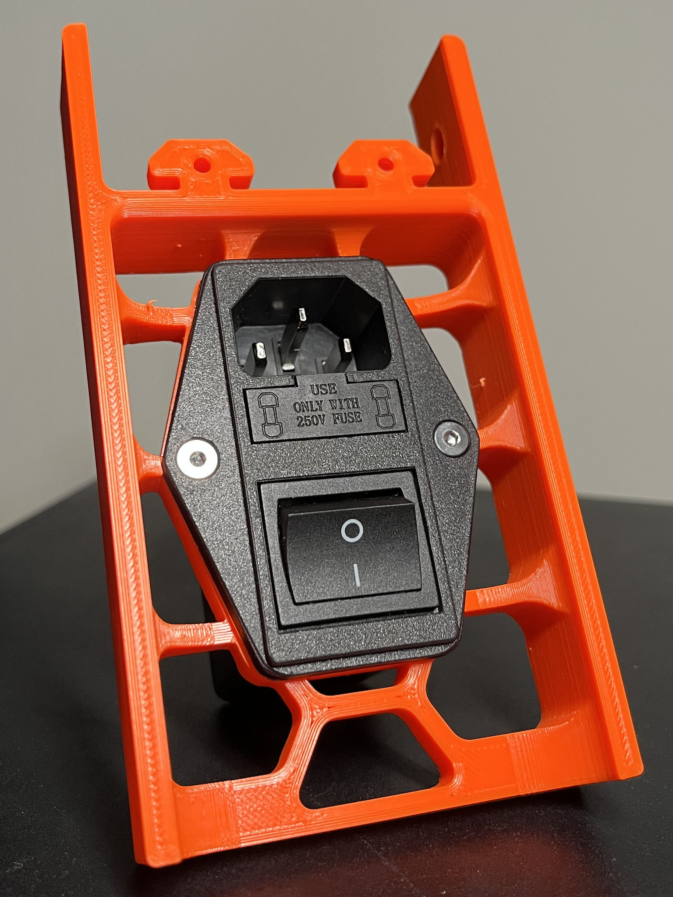
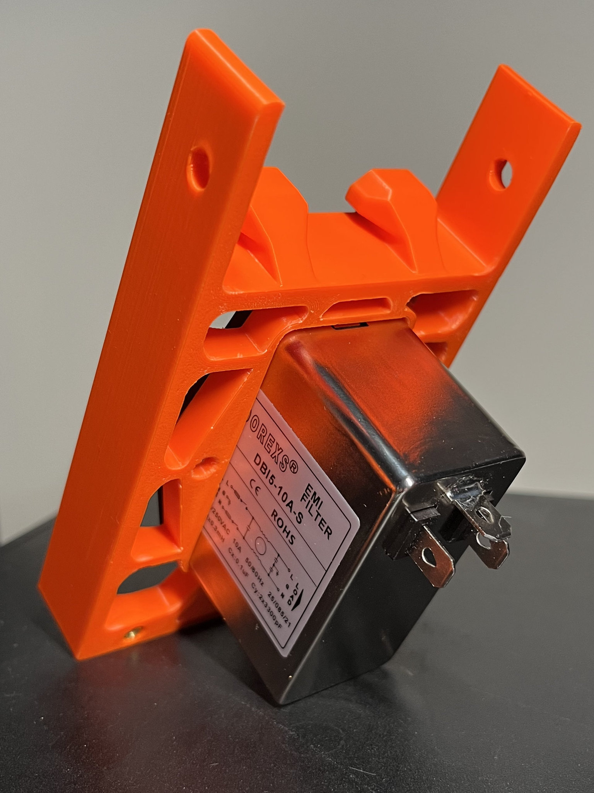

# Voron Theseus 3 V3

Modifications to accomodate Creality's Ender 3 V3 components.  

**[CLICK HERE TO DOWNLOAD](https://voron.zip/done/VSW.zip)**

The above link includes the stealthburner toolhead files which are compatible with several of the printers in the Voron lineup. 
To keep things organized, StealthBurner’s files are maintained separately. 
the Stealthburner Repository can be browsed by clicking [HERE](https://github.com/VoronDesign/Voron-Stealthburner)

The official release of the Voron Switchwire 3d printer.  You can find the BOM and any other relevant information at the [Voron Design]( http://vorondesign.com/voron_switchwire) website.

## Software

**Configuration files are WIP.**

It feels like Creality really needed to push the software out _fast_. They promised Creality OS in E3V3 marketing, but they're not planning on releasing it. Don't take my word for it, ask them yourself.  
No wonder, it's a disaster. Either that or I'm detached from what embedded software should look like.  

More information can be found in [the hardening guide](https://github.com/marecl/Theseus3V3/tree/master/Hardening).

## Custom parts

Obviously.

### Rear Left Grill
Front Side Grill adapted for a [large power inlet with integrated EMI filter](https://www.emcdorexs.com/product/dbi5.html).  

Used hardware:
1. 4x M3 threaded brass insert
2. 2x M3x8 FHCS (ISO 10642 / DIN 7991)

M3x6 FHCS may not thread fully into the insert.

### Front Left Grill
Stock grill. Copied only because original file name requested 2 pieces, while this project requires just 1.

### (WIP) Front Middle Grill
Front Middle Grill adapted for stock Ender 3V3 display (with case).  
Includes partial slit for LCD cable.

### (WIP) Front Right Grill
Front Side Grill adapted for stock Ender 3V3 display (with case).  
Includes mounting extrusion and slit for LCD cable.

### (WIP) Bed Drill Guide
Stock E3V3 bed doesn't have enough meat to properly mount the anchor. Yet to level-up from brief look at it.

### (WIP) Y Bed Anchor
Stock E3V3 bed doesn't have enough meat to properly mount the anchor. Yet to level-up from brief look at it.